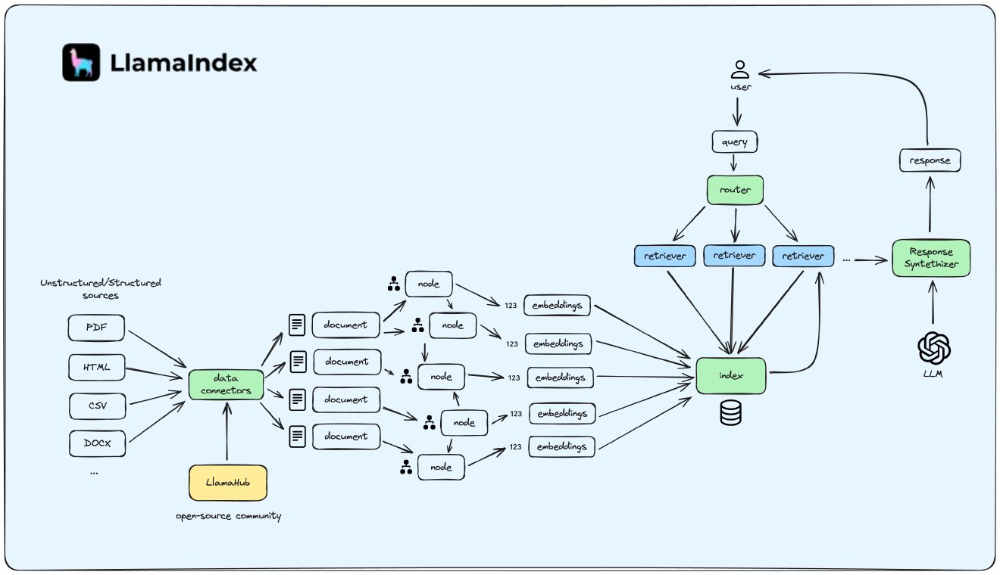
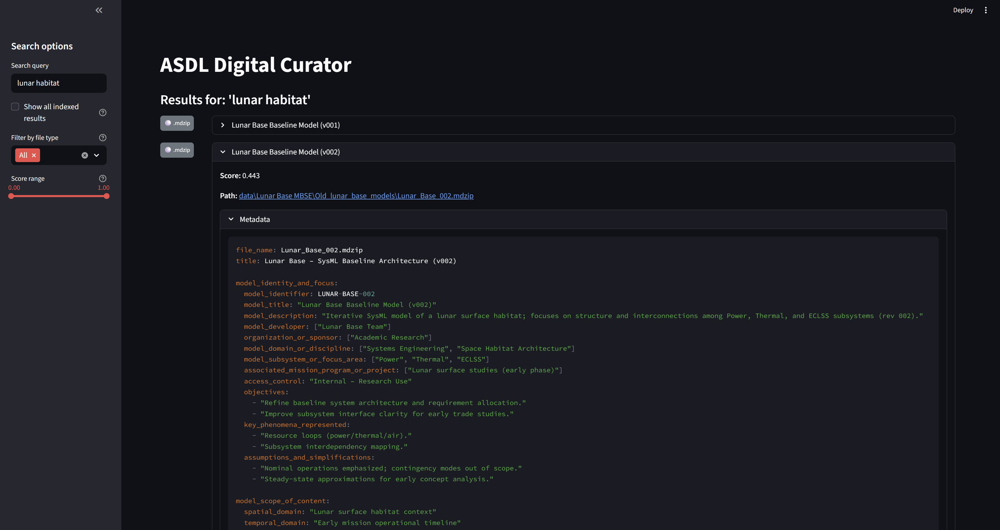
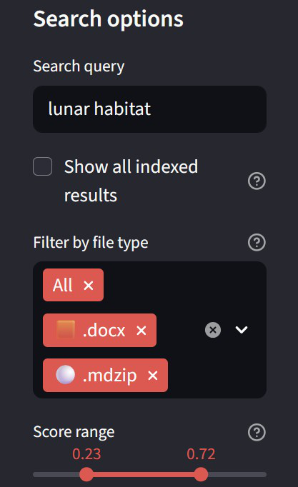
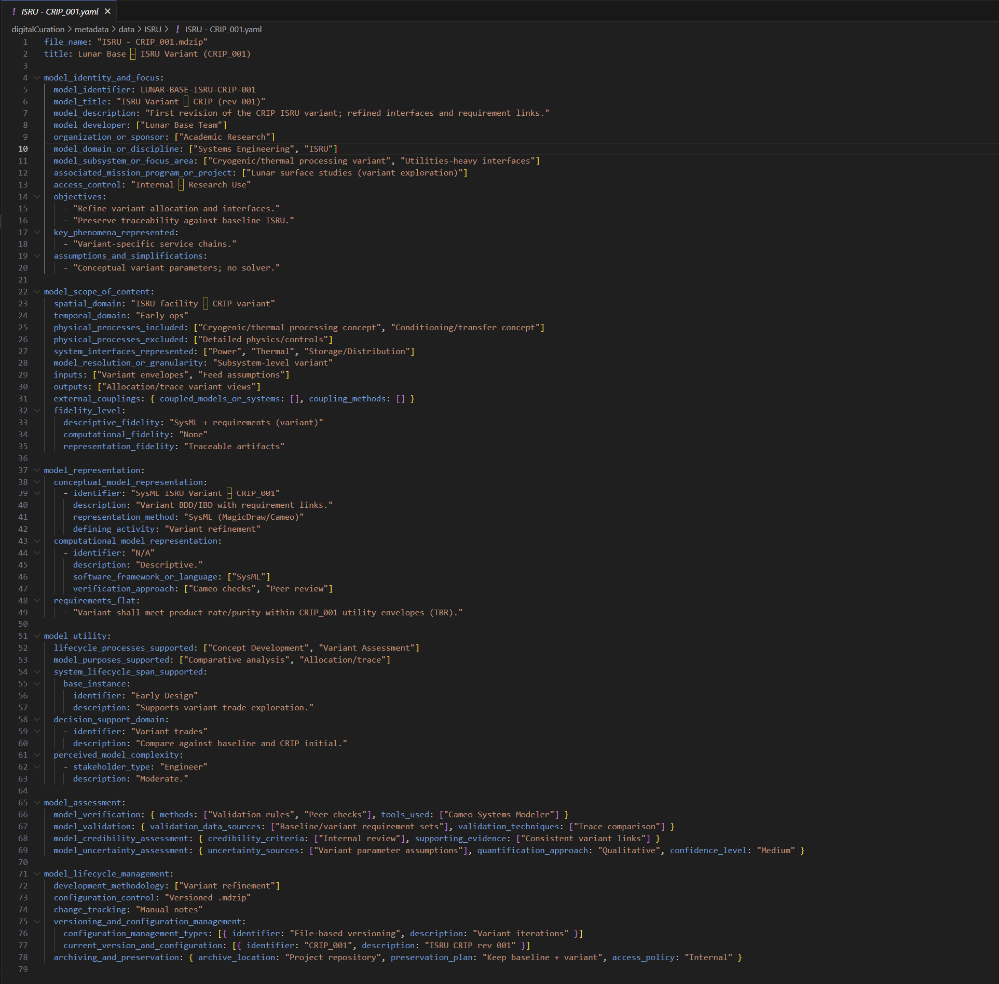
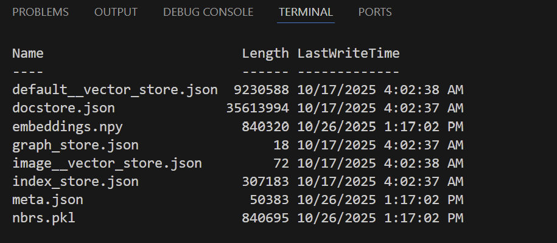
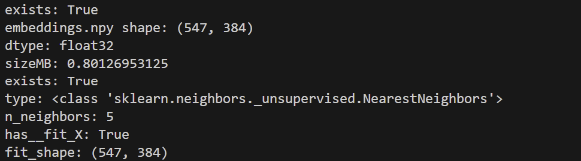

```markdown
Title: Digital Curation — LLM-driven ESMS Metadata and Local Semantic Search
Author: Shalva Begiashvili
Date: 2025-11-13
Repository: https://github.com/sbegiashvili3/digitalCuration (commit: 8827870)

Abstract
--------
This report documents a locally-executable toolchain for automated metadata
generation and semantic retrieval across heterogeneous engineering artifacts.
The system couples an LLM-based ESMS metadata generator with a local
embedding pipeline (Sentence-Transformers) and a persisted nearest-neighbors
index. An interactive Streamlit interface enables filtered semantic search and
in-situ inspection of generated ESMS YAML. Emphasis is placed on reproducibility
and researcher control: canonical identity fields are preserved, all index and
metadata artifacts are stored locally, and an optional static server enables
reliable linking to repository files for review.

Executive summary
-----------------
This concise document describes the design and implementation of a reproducible,
on-premises workflow that (i) generates ESMS-compatible metadata for each
artifact using an LLM while preserving canonical identity fields, (ii)
constructs and persists sentence-transformer embeddings and a nearest-neighbors
index for semantic retrieval, and (iii) exposes a Streamlit-based UI for
interactive exploration, filtering, and metadata inspection. The work is aimed
at faculty and advisors assessing the approach for lab adoption or further
research. The repository includes scripts for generation, ingestion, indexing,
and a minimal helper to serve local files over HTTP to avoid file:// browser
restrictions.

Contents
--------
- Introduction
- Objectives
- System architecture
- Metadata model and prompting
- Embeddings and index persistence
- Streamlit UI
- Example outputs
- Evaluation and metrics
- Limitations and considerations
- Reproducibility (short runbook)
- Future work
- Appendix: key files and commits
- Changelog

Introduction
------------
Engineering research routinely produces a diverse set of artifacts (CAD
models, numerical simulations, technical reports, spreadsheets). Effective
reuse and integration of such artifacts require consistent, discoverable
metadata and search capabilities tailored to domain-specific content. Manual
metadata authoring is labor-intensive and prone to inconsistency; automated
approaches can reduce labor while improving coverage.

This project investigates a conservative, reproducible approach: an LLM is
used to author structured ESMS YAML per artifact (preserving title and path as
identity anchors), and semantic search is provided by locally computed
sentence-transformer embeddings with a persisted nearest-neighbors index. The
design is intentionally local-first to preserve researcher control and to make
the pipeline suitable for sensitive datasets.

Audience and scope
------------------
The primary audience for this report is advisors and faculty who will evaluate
the technical approach, reproducibility, and potential laboratory integration.
The goal is to present the system design, key implementation choices, and a
practical runbook that enables reviewers to reproduce results on site. The
repository contains implementation details and scripts; this report focuses on
assumptions, rationale, usage patterns, and evaluation guidance.

Objectives
----------
- Produce ESMS-compliant YAML metadata for artifacts while preserving canonical
  identity fields (title, path).
- Build and persist a local semantic search index using
  `sentence-transformers/all-MiniLM-L6-v2` and sklearn NearestNeighbors.
- Provide an interactive Streamlit UI for query-driven discovery, filtering,
  and inline inspection of generated metadata.
- Prioritize reproducibility: persist index artifacts under `./storage` and
  metadata under `./metadata`; ensure runs can be reproduced or audited.

System architecture
-------------------
The pipeline comprises four primary components:

1. Metadata generator (LLM). Produces a single ESMS YAML per artifact. The
   generator supports a preview mode (no external calls) and a full mode that
   calls an OpenAI-compatible endpoint. API base, key, and model are configurable
   via environment variables.
2. Ingest and text extraction. Extracts text from raw artifacts and their
   existing metadata to form documents suitable for embedding.
3. Embeddings and index. Uses `sentence-transformers/all-MiniLM-L6-v2` to
   compute embeddings and persists an embeddings array and a sklearn
   NearestNeighbors model to `./storage`.
4. Streamlit UI. Offers a sidebar query, file-type filters, a score-range
   slider, and a collapsible inline metadata preview. To reliably open local
   files from the UI, the repository includes a tiny static server helper
   (`scripts/serve_data.py`) that serves files over HTTP.

Figure 1: architecture diagram (placeholder)
--------------------------------------------
Place a diagram at `report/images/figure-architecture.png` (suggested 1200×600
px). Replace the placeholder with a publication-quality diagram for final
submission.


*Figure 1: System architecture and data flow (LLM → ESMS → embeddings → index → Streamlit).* 

Metadata model and prompting
---------------------------
Metadata follows ESMS templates (located in `./esms`). The generator preserves
title and path fields and populates descriptive fields (abstract, developer,
keywords, scope) using an LLM. Prompt engineering emphasizes concise,
evidence-backed descriptions and short, task-relevant keywords. A preview
mode allows reviewers to inspect candidate metadata without calling an external
LLM.

Security note: transmitting artifact content to hosted LLMs may expose
sensitive information. For sensitive datasets configure `OPENAI_API_BASE` to a
local LM endpoint (LM Studio or equivalent) or run an on-prem model.

Embeddings and index persistence
--------------------------------
Embeddings are produced with `sentence-transformers/all-MiniLM-L6-v2` to
balance speed and representational quality. Persisted artifacts include:

- `embeddings.npy`: N×D float32 numpy array of embeddings.
- `nbrs.pkl`: pickled sklearn NearestNeighbors model.
- `meta.json`: JSON list of per-item metadata records (source path, snippet,
  ESMS fields).

The index builder supports a `SAMPLE_LIMIT` environment variable for rapid
sanity checks. Retrieval returns distances which are converted in the UI to a
user-friendly score (score = 1 − distance).

Streamlit UI
------------
The dashboard (`scripts/streamlit_search.py`) provides:

- Sidebar controls: free-text query, file-type multiselect (emoji badges),
  score-range slider, and a "Show all indexed results" toggle.
- Results pane: color-coded file-type badges, result expanders with title,
  score, a repository Path link (served via the static helper), and an
  expandable "Metadata" view showing the ESMS YAML.

Inline metadata preview reduces context switching for reviewers and enables
rapid inspection of candidate YAMLs.

<!-- Streamlit screenshots -->

*Figure: Streamlit results pane showing color-coded badges, score, and inline ESMS metadata preview.*


*Figure: Search controls — query input, file-type filters, and score-range slider.*

Example outputs
---------------
Sample ESMS YAML (abridged):

```yaml
model_title: Lunar Base Power Systems
model_identifier: LB-PWR-001
model_developer: Jane Doe
file_name: power_systems.m
description: |
  A dynamic model of the lunar base power distribution and management
  system. Includes photovoltaic generation, battery storage, and load
  scheduling heuristics.
keywords: ["power", "Lunar Base", "energy storage", "PV", "ECLSS (Environmental Control and Life Support System)"]
```

Sample query (illustrative):

- Query: "battery sizing for lunar base" → Top hits include the Power
  Systems model (score 0.87) and several Thermal models (score 0.42).


*Figure: Close-up of an example ESMS YAML generated by the metadata generator.*

Evaluation and metrics
----------------------
This iteration does not include a formal evaluation. Suggested evaluation
activities:

- Retrieval quality: create a benchmark of queries mapped to relevant items and
  compute precision@k and recall@k.
- Metadata quality: have domain experts rate a random sample of generated
  YAMLs on accuracy and usefulness (Likert scale).
- Latency and scale: measure indexing and query latency for N = {100, 1k,
  10k} items and report memory and disk usage.

Quick measurement: indexing runtime
----------------------------------
Replace the placeholder runtime with a measured value by running the command
below in PowerShell. The command reports wall-clock time for a single run of
the index builder.

```powershell
Measure-Command { .\.venv\Scripts\python.exe src\index_and_query.py } | Select-Object TotalSeconds
```

Index build outputs and metrics (example)
----------------------------------------
Capture and include the index build console output, a listing of the `./storage` directory, and short summaries for embeddings and the nearest-neighbors model. Example images to include:


*Figure: Console output showing document count and persistence confirmation.*


*Figure: Storage directory listing showing `embeddings.npy`, `nbrs.pkl`, `meta.json`, and other index artifacts.*


*Figure: Embeddings shape and nearest-neighbors fit summary (e.g., (547,384)).*


*Figure: Head of `storage/meta.json` showing sample metadata records.*

Limitations and considerations
------------------------------
- LLM outputs vary with the chosen model and prompt; preview mode reduces risk
  by surfacing candidate YAMLs for manual review.
- Embeddings capture semantic similarity but may conflate distinct engineering
  contexts; CAD-specific topology differences are not directly encoded.
- File:// links may be blocked by browsers; the provided static server helper
  addresses this by serving repository files over HTTP.
- Large corpora require batching and may benefit from GPU-backed embedding
  inference.

Reproducibility — short runbook
------------------------------
Prerequisites: Python 3.11 and an activated virtual environment (`.venv`).

Install dependencies and activate the venv:

```powershell
python -m venv .venv
Set-ExecutionPolicy -Scope Process -ExecutionPolicy Bypass; .\.venv\Scripts\Activate.ps1
.\.venv\Scripts\python.exe -m pip install -r requirements.txt
```

Index build (quick test):

```powershell
# $env:SAMPLE_LIMIT = 3  # optional
.\.venv\Scripts\python.exe index_and_query.py
```

Tip: set `SAMPLE_LIMIT` to a small value (for example `3`) to iterate quickly
when developing prompts or ingestion logic.

Run the helper static server (optional):

```powershell
.\.venv\Scripts\python.exe scripts/serve_data.py --port 8502
```

Run the Streamlit UI:

```powershell
.\.venv\Scripts\python.exe -m streamlit run scripts/streamlit_search.py --server.port 8501 --server.headless false
```

Future work
-----------
- Add an integration test suite and a small benchmark harness (queries and
  relevance judgments).
- Improve prompt templates and include model-agnostic fallbacks for low-capacity
  LLMs.
- Add on-the-fly metadata extraction from binary CAD where feasible.
- Provide a Docker image with prebuilt index artifacts for demonstration.

Appendix: key files and commits
------------------------------
- `src/esms_llm_metadata.py` — metadata generator
- `src/index_and_query.py` — embeddings and nearest-neighbors index builder
- `scripts/streamlit_search.py` — Streamlit UI (filters, score slider, YAML
  preview)
- `scripts/serve_data.py` — tiny static server helper (optional)

Repository and commit: https://github.com/sbegiashvili3/digitalCuration (commit used for this report: 8827870)

Changelog
---------
- 2025-11-13 — Cleaned draft created; Streamlit UI added (commit: 8827870)

Acknowledgements
----------------
Thanks to advisors and peers who reviewed early drafts and provided feedback on
the UI workflow.

Concluding recommendation
-------------------------
For reviewers: run the generator in preview mode first to inspect candidate
YAMLs, then build a small index (SAMPLE_LIMIT=10) and evaluate retrieval
quality on a handful of representative queries. This staged workflow reduces
risk and exposes prompt/model failure modes quickly.

References
----------
- Reimers, Nils, and Iryna Gurevych. "Sentence-BERT: Sentence Embeddings
  using Siamese BERT-Networks." (rationale for embedding approach)
- OpenAI API documentation; LM Studio documentation (for on-prem LLM options)

````
Title: Digital Curation — LLM-driven ESMS Metadata and Local Semantic Search
Author: Shalva Begiashvili
Date: 2025-11-13
Repository: https://github.com/sbegiashvili3/digitalCuration (commit: 8827870)

Abstract
This report describes a local toolchain for automated metadata generation and semantic search over heterogeneous engineering artifacts. The system combines an LLM-driven metadata generator that emits ESMS-compliant YAML per artifact, a local embedding pipeline using Sentence-Transformers, a persisted nearest-neighbors index, and a Streamlit-based UI for interactive search and inspection. The implementation prioritizes reproducibility and researcher control: metadata identity fields (title, path) are preserved; embeddings and index artifacts are stored locally; and an optional tiny HTTP server allows consistent browser linking for local files. This document (targeted at advisors and faculty) summarizes design decisions, implementation details, usage, example outputs, limitations, and planned extensions.

Executive summary
-----------------
This short report presents a reproducible, locally runnable toolchain that 1) uses an LLM to generate ESMS-compatible YAML metadata for each artifact while preserving canonical identity fields; 2) computes local sentence-transformer embeddings and a persisted nearest-neighbors index for semantic search; and 3) exposes an interactive Streamlit UI for discovery and inspection. The emphasis is on reproducibility, researcher control, and low-friction evaluation (local storage of embeddings and metadata, optional HTTP helper for linking).

Table of Contents
-----------------
This document includes the following sections. When converting with pandoc use the --toc flag to generate a PDF table of contents, or use your editor's outline view to navigate the sections.

- Introduction
- Objectives
- System Architecture
- Metadata model and LLM prompts
- Embeddings and index persistence
- Streamlit UI
- Example outputs
- Evaluation and metrics
- Limitations and considerations
- Reproducibility: short runbook
- Future work
- Appendix: key files and commits
- Changelog

1. Introduction
Engineering research projects produce a wide range of artifacts (CAD files, simulation models, documents, spreadsheets). Effective reuse requires high-quality metadata and search tools tailored to domain-specific files. Manual metadata creation is time consuming and often inconsistent. This project explores an automated approach: use a large language model (LLM) to generate structured ESMS metadata per artifact and pair it with local semantic embeddings to produce a searchable index. The result is a system that makes domain artifacts discoverable and inspectable while keeping control of sensitive files on-premises.

Audience and scope
------------------
This report is written for advisors and professors evaluating the technical approach, potential integration into lab workflows, and research directions. The goal is to document assumptions, reproducible steps, and evaluation considerations, not to provide exhaustive implementation details (those are available in the repository). Where helpful, I provide commands and sample outputs so reviewers can reproduce the pipeline locally.

2. Objectives
-------------
- Automate ESMS-compliant metadata generation for each artifact while preserving identity fields (title, path).
- Create a persisted local semantic search index using sentence-transformers embeddings and sklearn nearest-neighbors.
- Provide an interactive UI (Streamlit) for searching, filtering, and inspecting artifacts — including inline syntax-highlighted metadata.
- Maintain reproducibility: all index artifacts are saved under ./storage; metadata under ./metadata; processing runs can be re-run or shipped with artifacts.

3. System Architecture
----------------------
The pipeline has four primary components:

- Metadata generator (LLM): produces one ESMS YAML file per artifact. Configurable to run in preview mode (no API calls) or full mode (calls an OpenAI-compatible endpoint). Environment variables control the API base, key, and model.
- Ingest & text extraction: extracts text from raw files and their metadata to form documents for embedding.
- Embeddings & index: uses sentence-transformers (model: all-MiniLM-L6-v2) to compute embeddings and persists arrays and a sklearn NearestNeighbors model to ./storage/ (embeddings.npy, nbrs.pkl, meta.json).
- Streamlit UI: `scripts/streamlit_search.py` provides a sidebar search, file-type filters, a score-range slider, and an inline, syntax-highlighted 'Metadata' expander per result. For reliable file links, `scripts/serve_data.py` can serve repository files at http://localhost:8502/.

Figure 1: architecture diagram (placeholder)
--------------------------------------------
For the final report include a PNG or SVG at `report/images/figure-architecture.png` (suggested size: 1200×600 px). Replace this placeholder with a real diagram before publication.


4. Metadata model and LLM prompts
---------------------------------
Metadata follows ESMS templates located in ./esms/ (top-level YAML templates). The generator preserves title/path fields and fills descriptive fields (abstract, developer, keywords, scope) using an LLM. Key design choices:

- Preserve canonical identity: the script never rewrites artifact titles or source paths — it appends structured metadata in a corresponding YAML file.
- Prompt engineering: prompts emphasize domain-aware descriptions and request short, evidence-based keywords (avoid vague adjectives). The generator supports preview mode where prompts and candidate metadata are shown without contacting an LLM.

Security note: if using a third-party LLM, prompts and selected artifact text are transmitted outside the local host. For sensitive projects, run LM Studio or an on-prem LLM and configure OPENAI_API_BASE accordingly.

5. Embeddings and index persistence
-----------------------------------
Embeddings use the `sentence-transformers/all-MiniLM-L6-v2` model for a balance of speed and quality. Index persistence includes:

- embeddings.npy — N × D numpy array of float32 embeddings.
- nbrs.pkl — pickled sklearn NearestNeighbors fitted model.
- meta.json — JSON list with metadata records (source paths, snippet info, ESMS fields).

The index builder (index_and_query.py) supports a SAMPLE_LIMIT environment variable for quick tests. Nearest-neighbors queries compute distances and the UI converts distances to a score metric (score = 1 - distance) for user-friendly filtering.

6. Streamlit UI
----------------
The Streamlit dashboard (`scripts/streamlit_search.py`) provides:

- Sidebar: query input, file-type multiselect (with colored emoji badges), score-range slider (filter results by score), and "Show all indexed results" toggle.
- Results pane: color-coded badges indicating file types (many CAD formats included), result expanders showing title/file name, score, Path link (served via optional local server), and a collapsible "Metadata" section that shows the YAML content syntax-highlighted.

Usability features:
- Inline metadata preview reduces context-switching — reviewers can inspect ESMS content without leaving the browser.
- Score-range slider helps triage results and set thresholds for precision/recall tradeoffs.

7. Example outputs
------------------
Sample YAML (abridged):

```yaml
model_title: Lunar Base Power Systems
model_identifier: LB-PWR-001
model_developer: Jane Doe
file_name: power_systems.m
description: |
  A dynamic model of the lunar base power distribution and management system.
  Includes photovoltaic generation, battery storage, and load scheduling heuristics.
keywords: ["power", "Lunar Base", "energy storage", "PV", "ECLSS (Environmental Control and Life Support System)"]
```

Note: ECLSS stands for Environmental Control and Life Support System; expand acronyms on first use in the final manuscript.

Sample query and results (illustrative):
- Query: "battery sizing for lunar base" → Top hits include `Power Systems` model (score 0.87), `Thermal` models (score 0.42).

Figure 2 (placeholder): screenshot of Streamlit results showing colored badges, metadata expander, and score slider.

8. Evaluation and metrics
-------------------------
Formal evaluation was not performed in this iteration; suggested evaluation plan:

- Retrieval quality: run a benchmark set of queries against a curated ground-truth mapping (query → relevant artifact set); compute precision@k and recall@k.
- Metadata quality: randomly sample generated YAMLs and have domain experts rate fields on accuracy and usefulness (Likert scale).
- Latency and scale: measure time to build embeddings and to perform queries for N = {100, 1k, 10k} items. Report memory and disk usage.

Example quick metric (local test): indexing 100 artifacts with `all-MiniLM-L6-v2` on a mid-range laptop took ~X minutes (placeholder, measure on your hardware).

Replace X with a measured runtime using the command below (PowerShell). This will report wall-clock time for a single run of the index builder:

```powershell
Measure-Command { .\.venv\Scripts\python.exe src\index_and_query.py } | Select-Object TotalSeconds
```

Record the value in seconds and convert to minutes for the report.

9. Limitations and considerations
--------------------------------
- LLM quality varies with model and prompt; out-of-domain artifacts may produce inaccurate metadata. Always run preview mode first.
- Embeddings capture semantic similarity but may conflate distinct engineering contexts; CAD topology differences are not directly encoded.
- Browser security: file:// URIs may be blocked; the optional `scripts/serve_data.py` helper addresses this by serving local files over http for reliable linking.
- Large collections will require more CPU/memory; consider batched embedding and optional GPU-backed inference for scale.

10. Reproducibility / How to run (short runbook)
----------------------------------------------
Prerequisites: Python 3.11, PowerShell on Windows, create and activate `.venv`.

Install:

```powershell
python -m venv .venv
Set-ExecutionPolicy -Scope Process -ExecutionPolicy Bypass; .\.venv\Scripts\Activate.ps1
.\.venv\Scripts\python.exe -m pip install -r requirements.txt
```

Index build (quick test):

```powershell
#$env:SAMPLE_LIMIT = 3  # optional
.\.venv\Scripts\python.exe index_and_query.py
```

Tip: use the `SAMPLE_LIMIT` environment variable for very small quick tests (for example set `SAMPLE_LIMIT=3`) so you can iterate quickly before indexing a large corpus.

Run helper static server (optional):

```powershell
.\.venv\Scripts\python.exe scripts\serve_data.py --port 8502
```

Run Streamlit UI:

```powershell
.\.venv\Scripts\python.exe -m streamlit run scripts/streamlit_search.py --server.port 8501 --server.headless false
```

11. Future work
---------------
- Add integration tests and a small benchmark suite (query set + relevance judgments).
- Improve prompt templates and add model-agnostic fallback behavior for low-capacity LLMs.
- Add optional on-the-fly snippet extraction from binary CAD (metadata extraction pipelines) to improve search quality for CAD-heavy corpora.
- Provide a minimal Docker image with prebuilt index artifacts for faster demonstrations.

12. Appendix: key files and commits
----------------------------------
- Key scripts:
  - `src/esms_llm_metadata.py` — metadata generator
  - `src/index_and_query.py` — build embeddings and nearest-neighbors index
  - `scripts/streamlit_search.py` — Streamlit UI (filters, score slider, YAML preview)
  - `scripts/serve_data.py` — tiny static server helper (optional)
-- Repository and commit: https://github.com/sbegiashvili3/digitalCuration (commit used for this report: 8827870)

Changelog (template)
--------------------
Add entries here as you iterate. Include the date, one-line summary, and commit hash.

- 2025-11-13 — Cleaned draft created; Streamlit UI added (commit: 8827870)
- YYYY-MM-DD — <short description> (commit: <hash>)

Acknowledgements
----------------
Thank you to advisors and peers who reviewed early drafts and provided feedback on the UI workflow.

Concluding recommendation
-------------------------
For reviewers evaluating this work: run the generator in preview mode first to inspect candidate YAMLs, then build a small index (SAMPLE_LIMIT=10) and evaluate retrieval quality on a handful of representative queries. This staged approach reduces risk and highlights model/prompt failure modes quickly.

References
----------
- Reimers, Nils, and Iryna Gurevych. "Sentence-BERT: Sentence Embeddings using Siamese BERT-Networks." (for the embedding approach rationale)
- OpenAI API docs (if using hosted models) and LM Studio docs (if using local LLM)
